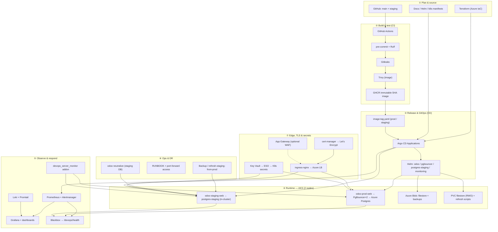

# odoo-devops-lab

Production-style **Odoo 17** on **Azure Kubernetes Service (AKS)** — Terraform, Helm, PgBouncer, GitOps, and observability. Includes a custom `devops_server_monitor` addon and local **Docker Compose** for development.

## Lab flow (vertical — DevOps phases)



**Public URLs (after ingress + TLS):** prod `https://<ip-dashes>.sslip.io` · staging `https://staging.<LB-IP-dots>.nip.io` — see [docs/aks/INGRESS.md](docs/aks/INGRESS.md). Odoo 17 routes **`/websocket` → 8072** via ingress (bus / live updates).

| Layer | Technology |
|-------|------------|
| Compute | **AKS** — **2 worker VMs** (fixed pool) |
| App | **Helm** — Odoo web + dedicated cron, rolling updates, PDB, HPA |
| DB pool | **PgBouncer** → single Azure Postgres Flexible Server |
| Filestore | **Azure Blob** — prod/staging containers + backup archives |
| Staging DB | **In-cluster PostgreSQL** — refresh from prod via scripts |
| IaC | **Terraform** — VNet, AKS, Postgres, storage |
| CI | **GitHub Actions** — lint, Trivy, push **GHCR** (immutable SHA tags) |
| CD | **Argo CD** — sync Helm values from git |
| Secrets | **Azure Key Vault** + External Secrets (default); Vault optional |
| Ingress / TLS | **ingress-nginx** + **cert-manager** (Let's Encrypt) — [INGRESS.md](docs/aks/INGRESS.md) |
| Observability access | **Grafana** port-forward; Loki query `{namespace="odoo"}` — [monitoring](docs/monitoring/README.md) |
| Local dev | **Docker Compose** — Postgres + Odoo on localhost |

## Repository layout

```text
├── addons/                 # Odoo modules
├── helm/odoo/              # Odoo chart (web + cron)
├── helm/pgbouncer/         # Connection pooler
├── helm/monitoring/        # kube-prometheus-stack, Loki
├── k8s/argocd/             # Argo CD Applications (ingress, cert-manager, monitoring, …)
├── k8s/cert-manager/       # Let's Encrypt ClusterIssuer template
├── k8s/external-secrets/   # Azure Key Vault ExternalSecrets
├── k8s/storage/            # Blob filestore notes
├── scripts/                # bootstrap, backup, staging refresh — see scripts/README.md
├── terraform/              # Azure infrastructure
├── docs/                   # Guides
└── docker-compose.yml      # Local development
```

## Quick start (local)

```bash
docker compose up -d --build
# http://localhost:8069
```

## Deploy to Azure (from your laptop)

**Full walkthrough:** **[docs/GETTING-STARTED.md](docs/GETTING-STARTED.md)** (`az login` → Terraform → kubectl → scripts).

```bash
./scripts/check-prerequisites.sh
az login && az account set --subscription "<your-sub>"
cd terraform && cp terraform.tfvars.example terraform.tfvars  # edit unique names
terraform init && terraform apply
./scripts/seed-keyvault-secrets.sh   # or seed-aks-db-secret.sh (fallback)
./scripts/install-external-secrets-azure.sh
./scripts/bootstrap-aks.sh
./scripts/install-ingress.sh
export LETSENCRYPT_EMAIL='you@example.com' && ./scripts/install-cert-manager.sh
# Enable hosts in helm/odoo/environments/*/ingress.yaml → push → Argo sync
```

## Documentation

| Topic | Guide |
|-------|--------|
| Overview | [docs/README.md](docs/README.md) |
| AKS + Helm | [docs/aks/README.md](docs/aks/README.md) · [Architecture](docs/aks/ARCHITECTURE.md) |
| Terraform | [docs/terraform/README.md](docs/terraform/README.md) |
| CI/CD & GitOps | [docs/cicd/README.md](docs/cicd/README.md) |
| Backups & DR | [docs/backup/README.md](docs/backup/README.md) |
| Monitoring | [docs/monitoring/README.md](docs/monitoring/README.md) |
| Secrets / Key Vault | [docs/secrets/README.md](docs/secrets/README.md) |
| Ingress | [docs/aks/INGRESS.md](docs/aks/INGRESS.md) |
| Vault (optional) | [docs/vault/README.md](docs/vault/README.md) |
| Local Docker | [docs/docker/README.md](docs/docker/README.md) |

## License

Personal / portfolio project — review Azure costs before applying Terraform.
